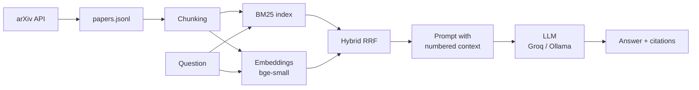

# RAG Eval Lab

[](https://github.com/arad1367/rag-eval-lab/actions/workflows/ci.yml)

A question-answering system over recent arXiv papers (cs.CL), plus a **controlled
experiment** that measures which retrieval method works best, with confidence intervals.

**Live demo:** https://YOUR-SERVICE.onrender.com (free plan: the first request after
15 idle minutes takes about a minute while the server wakes up)

## What it does

1. **Data:** downloads ~200 recent arXiv abstracts (`scripts/fetch_papers.py`).
2. **Retrieval:** three retrievers: BM25 (keywords), dense (embeddings), and hybrid (Reciprocal Rank Fusion).
3. **Generation:** an LLM answers using only the retrieved passages and cites them `[1]`.
4. **Evaluation:** a synthetic test set, Recall@k and MRR, bootstrap confidence intervals,
   paired significance tests, and LLM-as-a-judge for answer faithfulness.
5. **Engineering:** FastAPI service, pytest suite, ruff, Docker, GitHub Actions CI/CD,
   and automatic deployment to Render.

## Architecture



## Results

<!-- Replace this section with your own numbers from results/results.md -->

See [results/results.md](results/results.md) for the full table.


**Key findings (write 3 bullet points in your own words):**

- ...
- ...
- ...

**Limitations:** synthetic questions written by an LLM (may favour keyword overlap),
only ~50 questions (wide confidence intervals), abstracts only (no full text).

## Run it locally (Windows, Git Bash)

```bash
git clone https://github.com/arad1367/rag-eval-lab.git
cd rag-eval-lab
py -3.13 -m venv envy_ragy
source envy_ragy/Scripts/activate
pip install -r requirements-dev.txt
pip install -e .
cp .env.example .env        # then put your Groq key in .env
pytest                      # run the tests
uvicorn rag_lab.api:app --reload --port 8000
```

Open http://localhost:8000 (UI) or http://localhost:8000/docs (API docs).

## Reproduce the experiment

```bash
python scripts/fetch_papers.py --category cs.CL --n 200
python scripts/make_eval_set.py --n 50
python scripts/run_experiment.py
python scripts/judge_answers.py --n 15
```

## Project structure

```
src/rag_lab/        the library: config, data, embeddings, retrievers, llm, rag, metrics, api
scripts/            command-line steps: fetch data, make test set, run experiment, judge
tests/              pytest suite (offline: fake embedder + fake LLM)
notebooks/          exploratory data analysis (VS Code "# %%" cells)
results/            experiment outputs (table, chart, judge scores)
.github/workflows/  CI (lint, tests, Docker) and CD (deploy to Render)
render.yaml         Render Blueprint: the server described as code
```

## License

MIT
