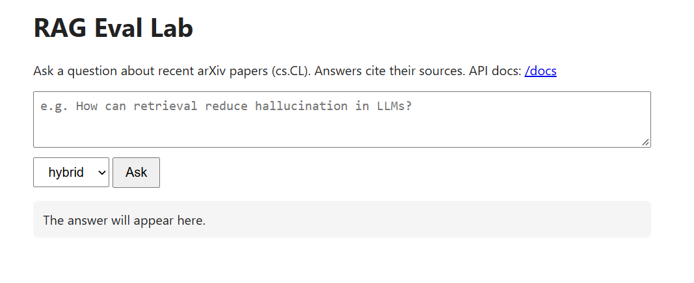
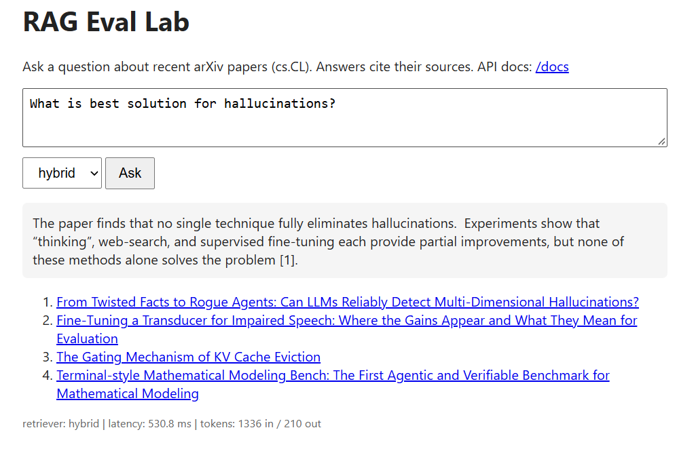
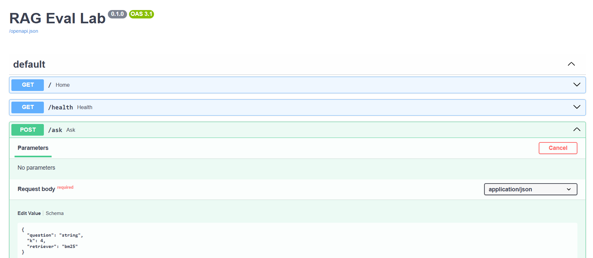
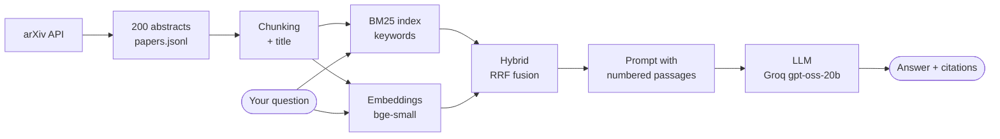
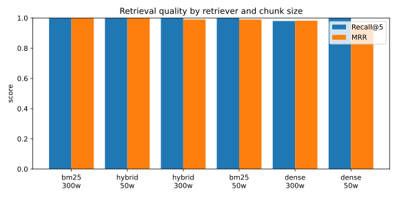

[](https://www.linkedin.com/in/pejman-ebrahimi-4a60151a7/)
[](https://huggingface.co/arad1367)
[](https://www.uni.li/pejman.ebrahimi?set_language=en)

# RAG Eval Lab

**Build · Measure · Ship.** A complete, beginner-friendly AI project: a question-answering
app over recent research papers, a real **evaluation experiment**, and a production-style
**FastAPI + Docker + CI/CD** pipeline, all in one small, readable codebase.

[](https://rag-eval-lab-sd1d.onrender.com/)
[](https://github.com/arad1367/rag-eval-lab/actions/workflows/ci.yml)


👉 **Try it live:** https://rag-eval-lab-sd1d.onrender.com/
(free hosting: if nobody used it for 15 minutes, the first request takes about a minute
while the server wakes up)


---

## Table of contents

- [What does this app do?](#what-does-this-app-do)
- [Why this project? (learn everything in one project)](#why-this-project-learn-everything-in-one-project)
- [Screenshots](#screenshots)
- [How it works, step by step](#how-it-works-step-by-step)
- [The experiment and results](#the-experiment-and-results)
- [Quick start](#quick-start)
- [Use the API](#use-the-api)
- [Reproduce the experiment](#reproduce-the-experiment)
- [Testing and CI/CD](#testing-and-cicd)
- [Project structure](#project-structure)
- [Tech stack](#tech-stack)
- [Limitations and next steps](#limitations-and-next-steps)
- [Contact](#contact)

---

## What does this app do?

You ask a question in plain English, for example *"What is the best solution for
hallucinations?"*. The app:

1. **searches** 200 recent arXiv research papers (Computational Linguistics, `cs.CL`)
   for the most relevant passages,
2. gives those passages to a **Large Language Model (LLM)**, and
3. returns a short **answer that cites its sources** `[1]`, `[2]`, with links to the papers.

This technique is called **RAG: Retrieval-Augmented Generation**. In simple words: instead of
letting the AI answer from memory (where it can "hallucinate"), we first *look things
up* and then let the AI answer **only from what we found**. If the papers don't contain
the answer, it says *"I don't know based on the provided papers."*

But the app is only half of the project. The other half is **measuring** it: which search
method finds the right paper most often, and is the difference statistically real?

## Why this project? (learn everything in one project)

AI Engineer, AI Researcher and Data Scientist job posts ask for the same core skills:
Python, LLMs, retrieval/RAG, evaluation, APIs, Docker, CI/CD and cloud deployment.
This repo puts **all of them in one project that a beginner can follow step by step**.
Each part is small, commented and tested, so you can read it in an afternoon.

| Area | What you learn here | Where in the code |
|---|---|---|
| **Python engineering** | virtual env, pinned dependencies, `src/` layout, config via environment variables | `pyproject.toml`, `config.py` |
| **Data** | calling an API, parsing XML, JSONL, exploratory data analysis | `scripts/fetch_papers.py`, `notebooks/01_eda.py` |
| **Embeddings** | text → vectors, cosine similarity, chunking with overlap | `embeddings.py`, `data.py` |
| **Retrieval** | BM25 keyword search, dense semantic search, hybrid with Reciprocal Rank Fusion | `retrievers.py` |
| **LLMs & RAG** | prompting, grounding, citations, temperature, token usage, retries | `llm.py`, `rag.py` |
| **Evaluation (research)** | test sets, Recall@k, MRR, bootstrap confidence intervals, paired significance tests, LLM-as-a-judge | `metrics.py`, `scripts/run_experiment.py`, `scripts/judge_answers.py` |
| **API** | FastAPI, request validation, health checks, logging, error handling | `api.py` |
| **Testing** | pytest, fixtures, fake models (tests run offline in seconds), ruff | `tests/` |
| **MLOps** | Docker, build-time caching, GitHub Actions CI, continuous deployment, infrastructure as code | `Dockerfile`, `.github/workflows/`, `render.yaml` |

**New to all this?** Read the files in the order of the [How it works](#how-it-works-step-by-step)
section. Every module starts with a short *Concepts* note in plain English. Then try each
building block yourself in `notebooks/02_playground.py`.

## Screenshots

**1. Ask a question** in the web interface, and choose the search method (hybrid, dense or BM25):



**2. Get a grounded answer with citations.** Every source links to its arXiv page. The
footer shows the retriever, latency and token usage:



**3. Interactive API documentation**, generated automatically by FastAPI at `/docs`:



## How it works, step by step



| Step | What happens | Key idea |
|---|---|---|
| **1. Collect data** | `fetch_papers.py` downloads the 200 newest `cs.CL` abstracts from the arXiv API and saves them as JSONL. | Save a snapshot so results are reproducible. |
| **2. Explore** | `01_eda.py` checks size, duplicates and lengths. The median abstract has **196 words**. | Look at the data before modelling. |
| **3. Chunk** | Each abstract is split into pieces (50 or 300 words, with overlap). The paper title is added to every chunk. | Smaller pieces match questions more precisely. |
| **4. Embed** | `bge-small-en-v1.5` turns each chunk into a 384-number vector (runs on CPU via ONNX, no GPU needed). | Similar meaning → similar vectors. |
| **5. Retrieve** | **BM25** finds shared keywords, **dense** finds similar meaning, **hybrid** merges both rankings with Reciprocal Rank Fusion. | Each method catches what the other misses. |
| **6. Generate** | The top passages go into a prompt with strict rules: use only this context, cite `[n]`, say "I don't know" otherwise. | Grounding reduces hallucination. |
| **7. Serve** | FastAPI exposes `/ask` and `/health`. The index is built **once at Docker build time**, so the server starts in seconds. | Do heavy work once, not per request. |

## The experiment and results

**Question:** which retriever (BM25, dense, hybrid) and which chunk size (50 or 300
words) finds the correct paper most often?

**Setup:** 200 papers · 50 test questions (one per sampled paper, written by an LLM) ·
6 configurations · metrics at paper level · 95% bootstrap confidence intervals ·
paired bootstrap tests.

| Chunk size | Retriever | Recall@1 | Recall@5 | MRR [95% CI] |
|---|---|---|---|---|
| 300 | BM25 | 1.00 | 1.00 | 1.000 [1.00, 1.00] |
| 50 | Hybrid | 1.00 | 1.00 | 1.000 [1.00, 1.00] |
| 300 | Hybrid | 0.98 | 1.00 | 0.990 [0.97, 1.00] |
| 50 | BM25 | 0.98 | 1.00 | 0.990 [0.97, 1.00] |
| 300 | Dense | 0.98 | 0.98 | 0.982 [0.95, 1.00] |
| 50 | Dense | 0.92 | 1.00 | 0.957 [0.91, 0.99] |



**Key findings**

- **Hybrid beats dense with small chunks.** With 50-word chunks, hybrid retrieval improves
  MRR by **+0.043** over dense (95% CI [+0.010, +0.090], p = 0.024): a statistically
  significant gain. With 300-word chunks the difference is not significant.
- **Dense retrieval suffers most from small chunks** (Recall@1 drops from 0.98 to 0.92):
  a 50-word piece loses context that the embedding needs.
- **The test set is too easy, and that is the most important lesson.** Plain keyword
  search (BM25) scores a perfect 1.0. The LLM-written questions reuse the papers' own
  words, which favours keyword matching (*lexical overlap bias*). Synthetic evaluation
  data is fast to make, but it must be checked; human-written questions would give a
  harder and more realistic benchmark.

Full report: [`results/results.md`](results/results.md). Answer faithfulness can also be
graded with an LLM judge: `python scripts/judge_answers.py`.

## Quick start

**Requirements:** Python 3.13, Git, and a free [Groq API key](https://console.groq.com/keys)
(or a local [Ollama](https://ollama.com) model). Commands below are for **Git Bash on
Windows**; on macOS/Linux use `python3 -m venv` and `source envy_ragy/bin/activate`.

```bash
# 1. Get the code
git clone https://github.com/arad1367/rag-eval-lab.git
cd rag-eval-lab

# 2. Create and activate a virtual environment
py -3.13 -m venv envy_ragy
source envy_ragy/Scripts/activate

# 3. Install dependencies and the project itself
pip install -r requirements-dev.txt
pip install -e .

# 4. Add your API key (the .env file is never committed)
cp .env.example .env        # then open .env and paste your Groq key

# 5. Run the tests (offline, a few seconds)
pytest

# 6. Start the app
uvicorn rag_lab.api:app --reload --port 8000
```

Open http://localhost:8000 (web app) or http://localhost:8000/docs (API docs).

> **Switch LLM provider without changing code:** any OpenAI-compatible API works. Set
> `LLM_BASE_URL`, `LLM_API_KEY` and `LLM_MODEL` in `.env` (see `.env.example` for Ollama).

## Use the API

```bash
curl -X POST https://rag-eval-lab-sd1d.onrender.com/ask \
  -H "Content-Type: application/json" \
  -d '{"question": "How can retrieval reduce hallucination in LLMs?", "k": 4, "retriever": "hybrid"}'
```

| Field | Type | Meaning |
|---|---|---|
| `question` | string, 3–500 chars | your question |
| `k` | int, 1–10 (default 4) | how many passages to give the LLM |
| `retriever` | `bm25` · `dense` · `hybrid` | search method (default: hybrid) |

The response contains `answer`, `sources` (title, arXiv URL, score), `usage` (tokens) and
`latency_ms`. Invalid input returns **HTTP 422** with a clear message.

## Reproduce the experiment

```bash
python scripts/fetch_papers.py --category cs.CL --n 200   # 1. download papers
python scripts/make_eval_set.py --n 50                    # 2. generate test questions (LLM)
python scripts/run_experiment.py                          # 3. compare 6 configurations
python scripts/judge_answers.py --n 15                    # 4. LLM-as-a-judge (faithfulness)
```

Results are written to `results/`. Random seeds are fixed, so the same data gives the
same numbers.

## Testing and CI/CD

- **28 unit tests** (`pytest`) cover chunking, XML parsing, retrieval, metrics, the
  embedding cache, the experiment and the API, including input validation. They use a
  fake embedder and a fake LLM, so they run **offline, free and in seconds**.
- **Lint and format** with `ruff`.
- **Continuous Integration** (`.github/workflows/ci.yml`): on every push, GitHub Actions
  runs lint → tests → Docker build → a **smoke test** that starts the container and calls
  `/health`.
- **Continuous Deployment** (`.github/workflows/deploy.yml`): when CI passes on `main`,
  GitHub Actions calls Render's deploy hook. Render builds the image, checks `/health`
  and switches traffic to the new version.
- **Infrastructure as code:** `render.yaml` describes the server (Docker, free plan,
  Frankfurt region, health check, secrets).

```
git push → CI: lint → tests → Docker build → smoke test → ✅ → CD: deploy hook → Render → live
```

## Project structure

```
rag-eval-lab/
├── src/rag_lab/            # the application library
│   ├── config.py           #   settings from environment variables
│   ├── data.py             #   load papers, chunking
│   ├── embeddings.py       #   text → vectors (fastembed / ONNX)
│   ├── retrievers.py       #   BM25, dense, hybrid (RRF)
│   ├── llm.py              #   OpenAI-compatible LLM client
│   ├── rag.py              #   retrieve → prompt → generate
│   ├── metrics.py          #   Recall@k, MRR, bootstrap statistics
│   ├── index.py            #   build the index once, cache it on disk
│   ├── api.py              #   FastAPI app (/, /health, /ask)
│   └── static/index.html   #   web interface
├── scripts/                # fetch data, make test set, run experiment, judge answers
├── notebooks/              # EDA and a hands-on playground (VS Code "# %%" cells)
├── tests/                  # 28 offline unit tests
├── data/                   # papers.jsonl, eval_questions.jsonl
├── results/                # experiment table, chart and report
├── .github/workflows/      # ci.yml, deploy.yml
├── Dockerfile  render.yaml  pyproject.toml  requirements*.txt
```

## Tech stack

| Purpose | Tools |
|---|---|
| Language | Python 3.13, pip, venv |
| Retrieval | `rank-bm25`, `fastembed` (BAAI/bge-small-en-v1.5, ONNX on CPU), NumPy |
| LLM | Groq API (`openai/gpt-oss-20b`) via the `openai` SDK; Ollama also supported |
| Data & analysis | pandas, matplotlib, arXiv API |
| Web | FastAPI, Pydantic, Uvicorn |
| Quality | pytest, ruff |
| Delivery | Docker, GitHub Actions, Render |

## Limitations and next steps

**Limitations:** the test set is synthetic and too easy (see findings); only 50
questions, so confidence intervals are wide; abstracts only, not full papers; the free
server sleeps when idle.

**Next steps:**
- write 30–50 human questions and compare with the synthetic set
- add a cross-encoder **re-ranker** and measure the gain
- index full paper text and test smarter chunking (by sentences or sections)
- store vectors in a vector database (Qdrant / pgvector) for larger collections
- add monitoring: latency p95, token cost, error rate

## Contact

**Pejman Ebrahimi**

- 📧 pejman.ebrahimi77@gmail.com · pejman.ebrahimi@uni.li
- 💼 [LinkedIn](https://www.linkedin.com/in/pejman-ebrahimi-4a60151a7/) ·
  🤗 [Hugging Face](https://huggingface.co/arad1367) ·
  🎓 [University profile](https://www.uni.li/pejman.ebrahimi?set_language=en)

If this project helped you learn, please ⭐ the repo. Questions and suggestions are welcome
as GitHub issues.

## License

[MIT](LICENSE)
