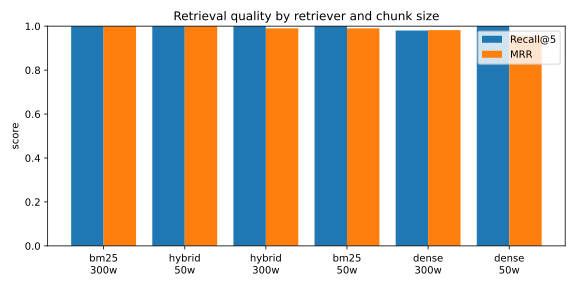

# Retrieval experiment results

- Papers: 200 | Questions: 50 | Embedding model: `BAAI/bge-small-en-v1.5`
- Metrics are at paper level (duplicate chunks of the same paper are merged).
- Brackets show 95% bootstrap confidence intervals.

| chunk_size | retriever | recall@1 | recall@1_ci | recall@5 | recall@5_ci | mrr | mrr_ci |
|---|---|---|---|---|---|---|---|
| 300 | bm25 | 1.0 | [1.00, 1.00] | 1.0 | [1.00, 1.00] | 1.0 | [1.00, 1.00] |
| 50 | hybrid | 1.0 | [1.00, 1.00] | 1.0 | [1.00, 1.00] | 1.0 | [1.00, 1.00] |
| 300 | hybrid | 0.98 | [0.94, 1.00] | 1.0 | [1.00, 1.00] | 0.99 | [0.97, 1.00] |
| 50 | bm25 | 0.98 | [0.94, 1.00] | 1.0 | [1.00, 1.00] | 0.99 | [0.97, 1.00] |
| 300 | dense | 0.98 | [0.94, 1.00] | 0.98 | [0.94, 1.00] | 0.982 | [0.95, 1.00] |
| 50 | dense | 0.92 | [0.84, 0.98] | 1.0 | [1.00, 1.00] | 0.957 | [0.91, 0.99] |

## Paired bootstrap tests

- hybrid vs dense (chunk 50, mrr): difference = +0.043, 95% CI [+0.010, +0.090], one-sided p = 0.024
- hybrid vs dense (chunk 300, mrr): difference = +0.008, 95% CI [+0.000, +0.024], one-sided p = 0.364
- hybrid vs bm25 (chunk 50, mrr): difference = +0.010, 95% CI [+0.000, +0.030], one-sided p = 0.379
- hybrid vs bm25 (chunk 300, mrr): difference = -0.010, 95% CI [-0.030, +0.000], one-sided p = 1.000

